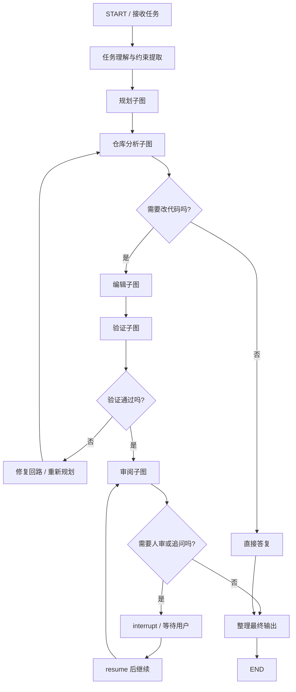
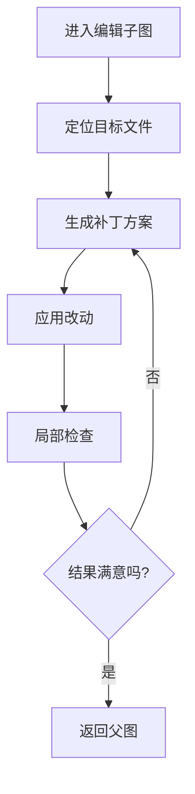

# LangGraph 子图 Subgraph：易懂中文详解

本文专门讲 LangGraph 里的 `subgraph`。如果你已经知道普通节点和普通边是什么，但还不知道“图里的图”为什么有意义，这篇就是给你的。

原始参考：
- [Subgraphs - LangChain Docs](https://docs.langchain.com/oss/python/langgraph/use-subgraphs)
- [Graph API overview - LangChain Docs](https://docs.langchain.com/oss/python/langgraph/graph-api)
- [Workflows and agents - LangChain Docs](https://docs.langchain.com/oss/python/langgraph/workflows-agents)

---

## 1. 一句话先讲清

`subgraph` 就是：

**把一整段有内部状态、有内部节点、有内部边的流程，当成父图里的一个可复用执行单元。**

你可以把它理解成：

- 普通节点：一小段逻辑
- 子图：一整段小流程

所以子图不是“语法糖”，而是结构化分层能力。

---

## 2. 为什么需要子图

当你的图开始变复杂时，如果还把所有节点铺在一张大图上，很快会出现几个问题：

- 主图过大，读不动
- 不同职责混在一起
- 某段流程难复用
- 不方便独立调试
- 不方便多 agent 分工

这时子图的作用就出来了。

适合拆成子图的典型场景：

- 规划流程
- 检索流程
- 工具执行流程
- 审核流程
- 某个专家 agent 的内部工作流

所以子图的本质不是“炫技”，而是：

**让复杂 agent 从一团逻辑，变成分层可维护结构。**

---

## 3. 子图和普通函数到底有什么区别

这个问题很关键。

很多人第一次看到子图，会说：

- 这不就是把代码封成函数吗？

不完全是。

普通函数通常只是：

- 接收参数
- 返回结果

而子图保留的是 LangGraph 自己的运行语义，例如：

- 子图内部也有状态
- 子图内部也能有分支和循环
- 子图内部也能 checkpoint
- 子图内部也能 interrupt / resume
- 子图内部也能继续调用别的子图

所以子图更像：

- “可运行的小型 agent/workflow 模块”

而不只是普通 Python 函数封装。

---

## 4. 两种最常见的接入方式

官方文档里，子图常见有两种用法。

### 4.1 方式一：在节点里手动调用子图

适合场景：

- 父图和子图的 state schema 不一样
- 你想手工控制输入输出映射

直觉上它像这样：

- 父图某个节点里 `subgraph.invoke(...)`
- 拿到结果后，自己组装回父图 state

### 4.2 方式二：把子图直接当成一个节点挂进父图

适合场景：

- 父图和子图共享某些 state key
- 你希望子图像普通节点一样接进父图

这时父图会把子图当成一个整体步骤来调用，但子图内部仍然保留自己的节点和边。

---

## 5. 先看第一个例子：不同 schema，用“节点内调用子图”

这个例子适合初学者理解，因为最直观。

### 5.1 目标

我们做一个父图：

- 父图接收用户任务
- 先调用一个“规划子图”
- 子图生成步骤计划
- 父图再根据计划生成最终结果

这里父图和子图用不同状态结构。

### 5.2 代码

```python
from typing_extensions import TypedDict

from langgraph.graph import START, END, StateGraph


class PlannerState(TypedDict):
    task: str
    plan: str


def planner_step_1(state: PlannerState) -> dict:
    # 子图第一步：识别任务类型
    return {"plan": f"先分析任务：{state['task']}"}


def planner_step_2(state: PlannerState) -> dict:
    # 子图第二步：补成一个更完整的计划
    return {"plan": state["plan"] + " -> 然后拆解步骤 -> 最后执行"}


planner_builder = StateGraph(PlannerState)
planner_builder.add_node("planner_step_1", planner_step_1)
planner_builder.add_node("planner_step_2", planner_step_2)
planner_builder.add_edge(START, "planner_step_1")
planner_builder.add_edge("planner_step_1", "planner_step_2")
planner_builder.add_edge("planner_step_2", END)
planner_graph = planner_builder.compile()


class ParentState(TypedDict):
    user_task: str
    plan_text: str
    final_output: str


def run_planner_subgraph(state: ParentState) -> dict:
    # 父图节点内部调用子图
    result = planner_graph.invoke({"task": state["user_task"]})

    # 把子图输出映射回父图状态
    return {"plan_text": result["plan"]}


def finalize(state: ParentState) -> dict:
    return {
        "final_output": f"收到任务：{state['user_task']}\n执行计划：{state['plan_text']}"
    }


parent_builder = StateGraph(ParentState)
parent_builder.add_node("run_planner_subgraph", run_planner_subgraph)
parent_builder.add_node("finalize", finalize)
parent_builder.add_edge(START, "run_planner_subgraph")
parent_builder.add_edge("run_planner_subgraph", "finalize")
parent_builder.add_edge("finalize", END)

parent_graph = parent_builder.compile()

result = parent_graph.invoke({"user_task": "修复 API 超时问题"})
print(result)
```

### 5.3 这个例子想让你看懂什么

这里的子图不是和父图共享整个状态，而是：

- 父图手工构造子图输入
- 子图独立运行
- 父图手工接回子图输出

这特别适合：

- schema 差异大
- 你想显式控制边界

---

## 6. 第二个例子：共享字段，用“直接把子图当节点”

如果父图和子图共享一部分状态字段，就可以更自然地把子图直接接进父图。

### 6.1 目标

我们做一个父图：

- 先进入“研究子图”
- 再进入“写答案节点”

研究子图负责累积 `facts`，父图最终使用这些 `facts` 产出答案。

### 6.2 代码

```python
from operator import add
from typing import Annotated
from typing_extensions import TypedDict

from langgraph.graph import START, END, StateGraph


class SharedState(TypedDict):
    question: str
    facts: Annotated[list[str], add]
    answer: str


def gather_fact_1(state: SharedState) -> dict:
    # 子图内部第一步：收集事实 1
    return {"facts": [f"问题是：{state['question']}"]}


def gather_fact_2(state: SharedState) -> dict:
    # 子图内部第二步：收集事实 2
    return {"facts": ["需要先确认上下文、范围和约束"]}


research_builder = StateGraph(SharedState)
research_builder.add_node("gather_fact_1", gather_fact_1)
research_builder.add_node("gather_fact_2", gather_fact_2)
research_builder.add_edge(START, "gather_fact_1")
research_builder.add_edge("gather_fact_1", "gather_fact_2")
research_builder.add_edge("gather_fact_2", END)
research_graph = research_builder.compile()


def write_answer(state: SharedState) -> dict:
    return {
        "answer": " | ".join(state["facts"])
    }


parent_builder = StateGraph(SharedState)

# 关键点：直接把子图作为一个节点接进父图
parent_builder.add_node("research_team", research_graph)
parent_builder.add_node("write_answer", write_answer)

parent_builder.add_edge(START, "research_team")
parent_builder.add_edge("research_team", "write_answer")
parent_builder.add_edge("write_answer", END)

parent_graph = parent_builder.compile()

result = parent_graph.invoke({"question": "如何设计 code agent？", "facts": []})
print(result)
```

### 6.3 这个例子的关键理解

这里父图和子图共享的是同一个大状态视角。

所以：

- 子图内部节点写入的 `facts`
- 父图后续节点可以直接继续使用

这类方式更适合：

- 状态字段高度共享
- 子图是父图流程中的自然一段

---

## 7. 子图最适合用来表达什么

### 7.1 多 agent 分工

这是最值得你重点理解的地方。

如果你要搭一个像 code agent 一样复杂的系统，通常不会只是一张平面图，而更像：

- 主图负责总控
- 各子图负责不同专家能力

例如：

- `planner_subgraph`
- `repo_analysis_subgraph`
- `edit_subgraph`
- `test_subgraph`
- `review_subgraph`

这就像一个总导演调多个专业小组。

### 7.2 可复用流程模块

如果一段流程会在多个任务里重复出现，比如：

- 检索 -> 过滤 -> 总结
- 读取文件 -> 分析改动点 -> 输出建议

那非常适合封成子图。

### 7.3 边界清晰的阶段

只要某一段内部逻辑相对完整，而且对外输入输出边界比较清晰，通常都适合独立成子图。

---

## 8. 如果拿 graph 搭 `Codex / Claude Code` 这类 code agent，图大概会长什么样

这里必须先强调：

**下面是工程推断图，不是官方公开的内部实现图。**

更准确地说，这是“如果你用 LangGraph 这类 graph runtime 来做一个强 code agent，合理的高层结构可能长什么样”。

### 8.1 高层主图通常像这样



### 8.2 这个图里“固定”的是什么

固定的是高层骨架，例如：

- 先理解任务
- 再规划
- 再看代码库
- 再改动
- 再验证
- 再审阅
- 再输出

### 8.3 这个图里“动态”的是什么

动态的部分很多，例如：

- 任务要不要重新规划
- 读哪些文件
- 调什么工具
- 改哪些文件
- 改几轮
- 测哪些命令
- 什么时候停止
- 是否请求人工确认

所以 graph 不是把 agent 变死，而是把 agent 的“骨架和边界”显式化。

### 8.4 子图层面可能再细分

比如“编辑子图”内部还可以继续拆：



这就是为什么强 agent 很适合 graph：

- 主图表达总流程
- 子图表达局部复杂工作流
- checkpoint 负责恢复
- interrupt 负责人类协作

---

## 9. 子图与 checkpoint 的关系

子图不只是结构问题，还会牵涉到状态持久化。

官方文档里，子图和 checkpoint 的关系是必须关注的。

### 9.1 默认：子图共享父图的 checkpoint 体系

这是最自然的理解方式：

- 父图有 thread
- 子图运行也属于这条 thread 的一部分

好处：

- 整条执行线能统一恢复
- 中断恢复更自然

### 9.2 子图也可以有自己的记忆边界

某些情况下你可能希望：

- 父图看起来是主流程
- 某个子图内部还维护自己的长期状态

这时可以考虑给子图独立持久化策略。

但初学阶段先记住一条就够：

**默认先把父图和子图当成同一条可恢复执行线来理解。**

---

## 10. 一个更接近“专家协作”的例子

这个例子模拟两个专家子图：

- `research_subgraph`
- `coding_subgraph`

父图负责总协调。

```python
from typing_extensions import TypedDict
from operator import add
from typing import Annotated

from langgraph.graph import START, END, StateGraph


class MainState(TypedDict):
    task: str
    notes: Annotated[list[str], add]
    patch_summary: str
    final_report: str


def research_step(state: MainState) -> dict:
    return {
        "notes": [
            f"先分析任务：{state['task']}",
            "确认受影响模块和接口"
        ]
    }


research_builder = StateGraph(MainState)
research_builder.add_node("research_step", research_step)
research_builder.add_edge(START, "research_step")
research_builder.add_edge("research_step", END)
research_subgraph = research_builder.compile()


def coding_step(state: MainState) -> dict:
    return {
        "patch_summary": "已根据分析结果生成补丁并完成局部自检"
    }


coding_builder = StateGraph(MainState)
coding_builder.add_node("coding_step", coding_step)
coding_builder.add_edge(START, "coding_step")
coding_builder.add_edge("coding_step", END)
coding_subgraph = coding_builder.compile()


def summarize(state: MainState) -> dict:
    return {
        "final_report": (
            "研究记录："
            + " / ".join(state["notes"])
            + "\n补丁摘要："
            + state["patch_summary"]
        )
    }


main_builder = StateGraph(MainState)
main_builder.add_node("research_team", research_subgraph)
main_builder.add_node("coding_team", coding_subgraph)
main_builder.add_node("summarize", summarize)

main_builder.add_edge(START, "research_team")
main_builder.add_edge("research_team", "coding_team")
main_builder.add_edge("coding_team", "summarize")
main_builder.add_edge("summarize", END)

main_graph = main_builder.compile()

result = main_graph.invoke(
    {
        "task": "修复支付回调幂等问题",
        "notes": []
    }
)
print(result)
```

### 这个例子真正表达的东西

重点不是“两个节点”，而是：

- 主图不关心研究子图内部怎么组织
- 主图也不关心编码子图内部怎么组织
- 主图只负责高层编排

这就是复杂 agent 最重要的分层方式之一。

---

## 11. 子图不是越多越好

这是很容易走偏的一点。

如果你把每两个节点都拆成子图，反而会：

- 结构碎片化
- 调试更难
- 状态边界更混乱

比较合理的拆分标准是：

- 这段流程本身有内部复杂度
- 这段流程以后可能复用
- 这段流程值得独立调试或独立演化

如果只是一个非常短的线性步骤，就没必要强拆。

---

## 12. 常见坑

### 12.1 把子图当普通函数理解

结果：

- 没有真正利用 graph 的状态、分支、恢复能力

### 12.2 父图和子图状态边界不清

结果：

- 到底谁写哪个 key 不清楚
- debug 时很容易乱

### 12.3 明明 schema 差异很大，却强行直接挂子图

结果：

- 状态映射很别扭
- 代码可读性变差

更好的做法是：

- 在节点里手工调用子图

### 12.4 子图过度拆分

结果：

- 图结构比业务逻辑还复杂

### 12.5 有状态子图被错误并发复用

如果某个子图自己持有状态或依赖特定 checkpoint 语义，那么并发复用时要非常小心。

否则你可能遇到：

- checkpoint 冲突
- 状态串线
- 难以解释的恢复行为

初学阶段最稳妥的策略是：

- 先把子图当成结构化流程模块
- 等完全理解 checkpoint 和 thread 以后，再做更复杂的并发/共享设计

---

## 13. 你真正该形成的理解

子图的本质不是“代码复用技巧”，而是：

**把复杂 agent 拆成多个可独立理解、可独立演化、可独立恢复的流程模块。**

所以如果你以后真的要搭一个强 code agent，更自然的思路通常不是：

- 一张巨大平面图包打一切

而是：

- 一个主图
- 多个职责清晰的子图
- 每个子图内部再有自己的节点和回路

这才更接近真实工程结构。

---

## 14. 学完这篇后你应该能回答

1. 子图和普通函数封装的根本区别是什么？
2. 什么时候应该在节点里手工调用子图？
3. 什么时候应该直接把子图挂成父图节点？
4. 为什么强 agent 更适合“主图 + 子图”分层，而不是一张超大平面图？

---

## 15. 和 checkpoint 连起来看

如果你把前一篇和这篇拼起来，实际上你已经看到复杂 agent 的两个关键底座：

- `checkpoint / resume`：解决执行线持久化
- `subgraph`：解决复杂度分层

再加上：

- `conditional edges`
- `Command`
- `interrupt`

你基本就能理解“为什么 graph 不是死流程，而可以搭 agent”。

---

## 16. 来源说明

本文依据官方文档整理改写：

- [Subgraphs - LangChain Docs](https://docs.langchain.com/oss/python/langgraph/use-subgraphs)
- [Graph API overview - LangChain Docs](https://docs.langchain.com/oss/python/langgraph/graph-api)
- [Workflows and agents - LangChain Docs](https://docs.langchain.com/oss/python/langgraph/workflows-agents)
