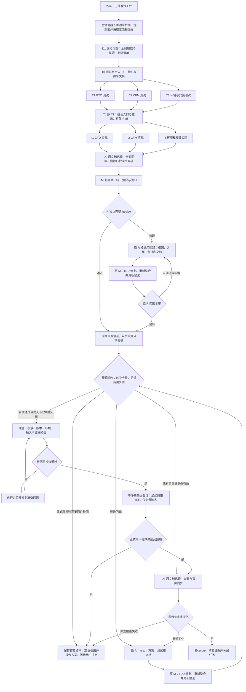
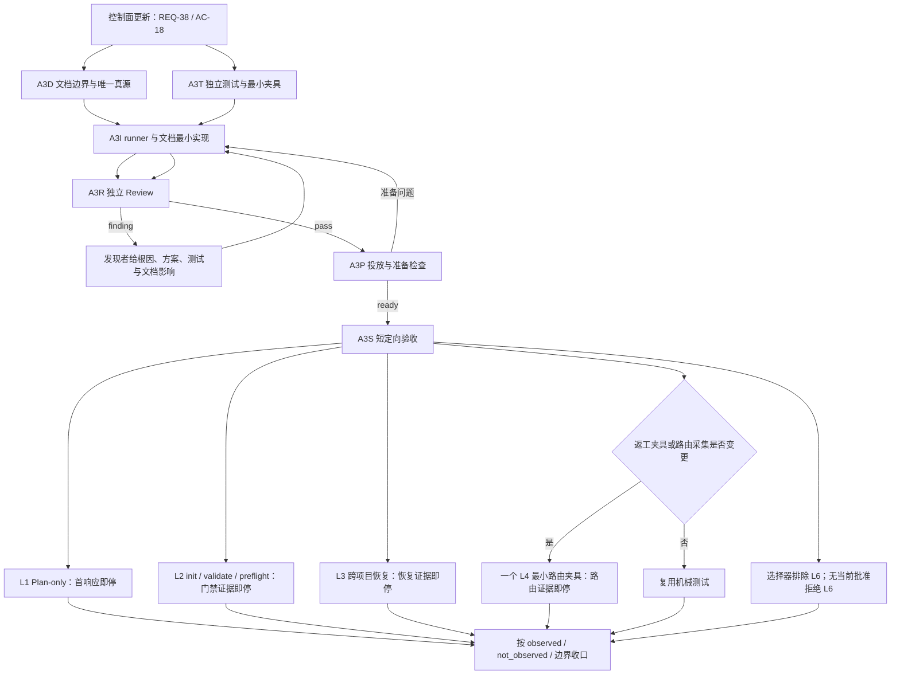

# GTO 核心工作流、CFM 与本地 harness 最小化收敛

> 已批准实施；本次由主协调器手动维护同一控制面。GTO 是被测改造对象，不驱动本次施工；旧校验缺陷仍须修复并验收。

Task ID: `20260911-140612-767128-harness-minimal-convergence`

## 施工目标

目标与全量要点见 [plan.md](plan.md#全量改造要点清单)；本文件只展开执行职责、顺序和边界。

## 前置条件

- 用户已确认六要点任务合同。
- 写入前已冻结范围、验收和风险。

## 执行顺序

见下方 [本次具体施工图](#本次具体施工图)，节点依赖以 state.subtasks 为准。

## 文档先行清单

D1 对照 [REQ 清单](plan.md#全量改造要点清单) 同步目标规范；D2、D3 的后续收口职责见任务表。

## 测试同步清单

T0/T1/T2/T3/TJ 按任务表建立独立测试、共享夹具与汇总检查，覆盖 REQ 引用的 AC 条目；新增 REQ-34 由 T1 建立 AC-15 覆盖检查。

## 实施批次

按 [本次具体施工图](#本次具体施工图) 的依赖推进；任务责任与交付见 [子任务明细](#子任务明细)。

## 每批写入范围

见 [子任务明细](#子任务明细) 的“修改边界”列和下方“派发、共享写入和批次约束”，不在此重复目录清单。

## 验证命令

实际入口集中于下方 [本次验证入口](#本次验证入口)；各项通过条件见 [acceptance.md](acceptance.md#验收标准)。

## 回退方案

风险见 [plan.md 的约束与依赖](plan.md#约束与依赖)。仅按冻结基线逐项撤回本任务引入的差异，保留用户既有改动、活动任务与 worktree；安装回退核对本次目标及 receipt。

## 审查与返工路径

普通 Review/验收沿用 [通用回路](../../../skills/global-task-orchestrator/references/usage-modes.md#回路与阶段出口)。黑盒先经准备检查及自主修复复查，再开展正式首轮；仅首轮效果未达预期进入报告出口。细节集中于 [验收流程](acceptance.md#验收执行流程)。

## 本次具体施工图

正常节点和依赖由 state.subtasks 展开；本次按 REQ-37 由主协调器直接操作平台工具，不调用 GTO 驱动。C/E/A0/AO/BB/H/Z 是 Plan/协调器或 A 的前置、验收子步骤和条件动作，不伪装子代理任务；RF/AF/修复和复审属于普通问题通用回路，H 是黑盒停止出口，实际 finding 出现后由本次主协调器追加真实记录，不预造已执行任务。

## 子任务明细

| 节点 | 责任与目标/交付 | 依赖 | 关键输入 | 修改边界 | 完成条件 |
| --- | --- | --- | --- | --- | --- |
| D1 | 文档先行与清理清单｜文档代理：逐条落实 REQ-01 至 REQ-37 中的目标规范；形成真源归属和可删除清单。仅目标规范先行，不宣称代码已实现。 | 主协调器已核对基线和授权 | docs/ARCHITECTURE.md docs/CODEX_COMPAT.md docs/SUBAGENT_GOVERNANCE.md docs/PROJECT_TEMPLATE.md docs/plans/AI_HARNESS_MASTER_PLAN.md README.md AGENTS.md rules/registry/RULES_ENTRY.md skills/global-task-orchestrator skills/command-failure-memory | docs/ARCHITECTURE.md docs/CODEX_COMPAT.md docs/SUBAGENT_GOVERNANCE.md docs/PROJECT_TEMPLATE.md docs/plans/AI_HARNESS_MASTER_PLAN.md README.md AGENTS.md rules/registry/RULES_ENTRY.md skills/global-task-orchestrator/SKILL.md skills/global-task-orchestrator/references/usage-modes.md skills/global-task-orchestrator/references/state-schema.md skills/pre-dev-benchmark skills/fix-closure-gate templates rules | 需求编号有归属，无相互冲突的现行规则；删除候选查调用和替代。 |
| T0 | 测试契约准备｜T1 测试负责人：确定 GTO/CFM/环境接口、AC 覆盖分工、共享夹具和组合入口；共享 fixture 仅 T1 写。 | D1 | skills/global-task-orchestrator skills/command-failure-memory skills/pre-dev-benchmark skills/fix-closure-gate scripts schemas templates rules tests/harness config/ai requirements.txt docs/ARCHITECTURE.md docs/CODEX_COMPAT.md docs/SUBAGENT_GOVERNANCE.md docs/PROJECT_TEMPLATE.md docs/plans/AI_HARNESS_MASTER_PLAN.md README.md AGENTS.md rules/registry/RULES_ENTRY.md | tests/harness/fixtures/harness-minimal-convergence | 测试独立于实现答案；关键边界与反例完整。 |
| T1 | GTO 初始测试｜测试负责人：为 DAG 文档先行、测试汇总、两条返工、角色字段、生成物、跨项目恢复、阶段、打包与重复回执建立最小有效 Red。 | T0 | skills/global-task-orchestrator schemas scripts/start_session.py | tests/harness/test_gto_workflow.py tests/harness/test_gto_initial_test_routing.py tests/harness/test_gto_consumer_validation.py tests/harness/test_gto_default_release.py tests/harness/test_gto_acceptance_retest_contract.py tests/harness/test_gto_review_regressions.py tests/harness/test_gto_coordinator_blocking.py  tests/harness/fixtures/harness-minimal-convergence | 覆盖 AC-01 至 AC-06、AC-12；记录失败原因及命中证明。 AC-15：完整清单及编号关联、缺项/悬空引用检查、同源更新和无多文档正文复制。 AC-16/17：准备故障可修复复查且不占正式首轮；有效首轮效果失败禁止自动第二轮，普通 finding 可循环；不得把效果失败重分类为准备。 |
| T2 | CFM 初始测试｜独立测试代理：隔离验证成功计数、新方案更新、签名降噪与不同故障区分、预期 Red 例外、旧记录去重保真。 | T0 | skills/command-failure-memory | tests/harness/test_command_failure_memory.py | 覆盖 AC-07/08；真实用户库前后未被测试写入。 |
| T3 | 环境与安装初始测试｜独立测试代理：验证实际解释器依赖、跨项目消费、同候选安装与 receipt、环境分工及旧工具禁令扫描。 | T0 | scripts config/ai requirements.txt | tests/harness/test_wsl_environment.py tests/harness/test_windows_native_environment.py tests/harness/test_sync_codex_scope.py tests/harness/test_gto_runner_environment_review.py tests/harness/test_gto_blackbox_runner.py | 覆盖 AC-09/10/14；缺 jsonschema 的环境应明确失败。 AC-16：投放/版本/环境/输入污染等检查失败后自行修复复查，成功才正式开测；保留准备日志且不记作效果失败。 |
| TJ | 测试汇总｜复用 T1：核对三个分支组合运行、夹具与覆盖，确认有效预期 Red；冲突回原测试者处理后再汇总。 | T1, T2, T3 | tests/harness | tests/harness/fixtures/harness-minimal-convergence | 不是要求全部 Green；不额外设测试整合代理；实现者不改断言。 |
| I1 | GTO 最小实现｜后续原整合者：实现 REQ-15 至 REQ-18、REQ-31：修正文档/测试/实施依赖模型，生成路由、恢复入口/阶段、角色合同、专属打包和最小持久化保护。 按 REQ-34 从同一合同生成完整要点清单和编号引用，检查责任/验收覆盖，不再生成重复正文。 按 REQ-35/36 区分顶层黑盒与普通验收，准备问题允许修复复查，正式首轮效果失败才机械阻止第二轮；不新增自动黑盒调度器。 | TJ | skills/global-task-orchestrator schemas scripts/start_session.py tests/harness | skills/global-task-orchestrator/scripts skills/global-task-orchestrator/references/revision-3-contract.example.json skills/global-task-orchestrator/references/revision-3-results.example.json schemas/orchestrator-task-state.schema.json scripts/start_session.py  skills/global-task-orchestrator/schemas/orchestrator-task-state.schema.json | T1 的 Red → Green → 相关回归；不以放宽独立性和依赖校验支持新 DAG。 |
| I2 | CFM 最小实现：按 T2 冻结用例修复计数、有效方案更新和保守签名归一；数据迁移只处理已查实差异。 | TJ | skills/command-failure-memory tests/harness/test_command_failure_memory.py | skills/command-failure-memory | T2 Red → Green → 相关回归；不访问测试范围外真实记忆库。 |
| I3 | 环境与安装最小实现：统一实际依赖和解释器检查、共享安装入口、receipt 与候选；核对权限证据并消除环境/文档测试误判。 | TJ | scripts config/ai requirements.txt tests/harness | scripts/bootstrap-local.py scripts/sync-codex.py scripts/doctor-core.py skills/windows-native-environment config/ai requirements.txt  tests/benchmarks/gto_blackbox.py tests/harness/test_pure_codex_cleanup.py | T3 Red → Green → 相关回归；本节点改源码，实际全局安装留 A0 条件准备。 |
| D2 | 全量文档收敛与废弃项删除｜原文档代理：按照实现事实同步全部现行规范、入口、示例、规则索引；在 D1 清单中确认已废弃/已替代的旧代码测试文档才删除。完成后交 M 整合。 | I1, I2, I3 | skills/global-task-orchestrator skills/command-failure-memory skills/pre-dev-benchmark skills/fix-closure-gate scripts schemas templates rules tests/harness config/ai requirements.txt docs/ARCHITECTURE.md docs/CODEX_COMPAT.md docs/SUBAGENT_GOVERNANCE.md docs/PROJECT_TEMPLATE.md docs/plans/AI_HARNESS_MASTER_PLAN.md README.md AGENTS.md rules/registry/RULES_ENTRY.md | docs/ARCHITECTURE.md docs/CODEX_COMPAT.md docs/SUBAGENT_GOVERNANCE.md docs/PROJECT_TEMPLATE.md docs/plans/AI_HARNESS_MASTER_PLAN.md README.md AGENTS.md rules/registry/RULES_ENTRY.md skills/global-task-orchestrator/SKILL.md skills/global-task-orchestrator/references/usage-modes.md skills/global-task-orchestrator/references/state-schema.md skills/pre-dev-benchmark skills/fix-closure-gate templates rules agents contexts hooks .superpowers output/imagegen sandbox/rules-evals/runs sandbox/rules-evals/process-runs memories scripts schemas tests/harness | 无活动引用、必要覆盖保留；禁止删除 base/process-base、活动任务/worktree、未核清 CFM 独有记录。 工具拒绝的目录删除保持未完成并记录原始错误，不换路径/工具绕过。 |
| M | 统一整合｜复用 I1：联通 GTO/CFM/规则/安装/环境契约，验证组合运行和全部文档清理改动；冻结送审差异。 | D2 | skills/global-task-orchestrator skills/command-failure-memory skills/pre-dev-benchmark skills/fix-closure-gate scripts schemas templates rules tests/harness config/ai requirements.txt docs/ARCHITECTURE.md docs/CODEX_COMPAT.md docs/SUBAGENT_GOVERNANCE.md docs/PROJECT_TEMPLATE.md docs/plans/AI_HARNESS_MASTER_PLAN.md README.md AGENTS.md rules/registry/RULES_ENTRY.md | skills/global-task-orchestrator skills/command-failure-memory skills/pre-dev-benchmark skills/fix-closure-gate scripts schemas templates rules tests/harness config/ai requirements.txt docs/ARCHITECTURE.md docs/CODEX_COMPAT.md docs/SUBAGENT_GOVERNANCE.md docs/PROJECT_TEMPLATE.md docs/plans/AI_HARNESS_MASTER_PLAN.md README.md AGENTS.md rules/registry/RULES_ENTRY.md | 相关测试通过且每个修复有命中证明；不混入未知脏改动。 |
| R | 首次完整 Review｜独立 Reviewer：独立审查 AC-01 至 AC-17 的需求、实现、测试质量、边界与全部文档；发现者按通用回路写问题合同。 | M | skills/global-task-orchestrator skills/command-failure-memory skills/pre-dev-benchmark skills/fix-closure-gate scripts schemas templates rules tests/harness config/ai requirements.txt docs/ARCHITECTURE.md docs/CODEX_COMPAT.md docs/SUBAGENT_GOVERNANCE.md docs/PROJECT_TEMPLATE.md docs/plans/AI_HARNESS_MASTER_PLAN.md README.md AGENTS.md rules/registry/RULES_ENTRY.md | tests/harness docs/ARCHITECTURE.md docs/CODEX_COMPAT.md docs/SUBAGENT_GOVERNANCE.md docs/PROJECT_TEMPLATE.md docs/plans/AI_HARNESS_MASTER_PLAN.md README.md AGENTS.md rules/registry/RULES_ENTRY.md skills/global-task-orchestrator/SKILL.md skills/global-task-orchestrator/references/usage-modes.md skills/global-task-orchestrator/references/state-schema.md skills/pre-dev-benchmark skills/fix-closure-gate templates rules | 首次完整审查，后续基于 finding 与 delta 范围复审；记录真实 CLI 使用及非 UI 适用性。 |
| A | 真实验收｜独立验收者：R 通过后按 acceptance.md 执行：普通验收保留循环；黑盒投放、版本、环境、污染等准备问题自行修复复查，就绪后在新顶层会话开展正式首轮。首轮效果未达预期定位根因、报告方案，不自动修复再开第二轮。 | R | skills/global-task-orchestrator skills/command-failure-memory skills/pre-dev-benchmark skills/fix-closure-gate scripts schemas templates rules tests/harness config/ai requirements.txt docs/ARCHITECTURE.md docs/CODEX_COMPAT.md docs/SUBAGENT_GOVERNANCE.md docs/PROJECT_TEMPLATE.md docs/plans/AI_HARNESS_MASTER_PLAN.md README.md AGENTS.md rules/registry/RULES_ENTRY.md | tests/harness docs/ARCHITECTURE.md docs/CODEX_COMPAT.md docs/SUBAGENT_GOVERNANCE.md docs/PROJECT_TEMPLATE.md docs/plans/AI_HARNESS_MASTER_PLAN.md README.md AGENTS.md rules/registry/RULES_ENTRY.md skills/global-task-orchestrator/SKILL.md skills/global-task-orchestrator/references/usage-modes.md skills/global-task-orchestrator/references/state-schema.md skills/pre-dev-benchmark skills/fix-closure-gate templates rules | AC-01 至 AC-17 分别留证；准备检查、正式首轮和普通验收结果分开记录。 准备通过后按 BB-01 至 BB-04 预定场景观察首轮，可复用真实覆盖；新顶层会话显式调用 skill 且无流程提示。 准备问题允许自主修复/复查；有效首轮效果未达预期不得自动派产品修复或开启第二轮；正常确认不构成提示。 |
| D3 | 最终文档与事实同步｜原文档代理：根据真实验收结果补遗漏文档和事实，向主协调器提交六工件回填材料；实质行为/契约/配置变化回验收回路。 | A | docs/ARCHITECTURE.md docs/CODEX_COMPAT.md docs/SUBAGENT_GOVERNANCE.md docs/PROJECT_TEMPLATE.md docs/plans/AI_HARNESS_MASTER_PLAN.md README.md AGENTS.md rules/registry/RULES_ENTRY.md | docs/ARCHITECTURE.md docs/CODEX_COMPAT.md docs/SUBAGENT_GOVERNANCE.md docs/PROJECT_TEMPLATE.md docs/plans/AI_HARNESS_MASTER_PLAN.md README.md AGENTS.md rules/registry/RULES_ENTRY.md | 不新增纯文档双人审查；本次主协调器更新任务状态并核验后才关闭。 普通验收与正式黑盒证据均通过才结项；准备复查不是效果轮次，首轮效果失败待用户决定的状态不能被事实同步覆盖。 |

## 派发、共享写入和批次约束

最多同时运行三个子代理。D1/D2/D3 复用原文档代理；T0/T1/TJ 复用测试负责人；M 复用 I1；R 与 A 使用独立真实身份。实际派发与结果见 state.json；逻辑职责不等于平台已成功创建身份。

T0/TJ 的共享 fixture 与 T1 分支测试串行；T1/T2/T3 并行写各自测试文件；I1/I2/I3 并行写各自模块。I1 持有 GTO schema、控制器和专属资源迁移；I3 持有共享安装/环境脚本；D2 在三者结束后统一做引用、模板、废弃项删除。新专属文件放 skill 内部；上表计划新增的测试文件名由 T0 查现有测试布局后就地选用，不无故新建第二套测试。需要更改共享文件先明确本轮唯一写入者。

普通审查/验收写证明测试和受影响正式文档只在其发现问题的回路中发生，不能与 M 同时写同一文件。作为产品运行输入的 SKILL/references/rules 需区分运行行为与说明：不因后缀为 Markdown 就当最终纯文字直接结项。受控六工件由协调器/控制器维护，文档代理提供事实补齐材料。

A0/PG/PF 是开测前准备与自主修复复查，属于 A 内部操作；BB/J 才是正式第一轮效果验收。普通验收先收敛，准备就绪后正式开测；仅效果未达预期的 H 出口没有自动进入第二轮的回边。细节见 [验收执行流程](acceptance.md#验收执行流程)。

## 本次验证入口

项目 CLI 命令在 Ubuntu-24.04 的本仓 WSL 路径执行；黑盒的新建/读取顶层会话使用当前平台原生任务工具。测试者先阅读实际 CLI --help 与现有测试布局，再冻结最小目标命令，不把以下入口清单视为已经运行成功的记录。

- 环境：已安装 project-env-doctor.py，显式 --project-root 与 --environment；后续验证必须用项目实际解释器证明依赖完整。
- GTO：同一加载候选的 orchestrator_ctl.py --action validate --repo-root <业务根> --task-id <隔离被测任务ID> --json；隔离消费项目覆盖无 skills/rules、不同 cwd 和恢复阶段。
- 测试：tests/harness 现有 GTO、CFM、wsl_environment、windows_native_environment、sync_codex_scope、gto_runner_environment_review、gto_blackbox_runner 的最小 unittest 目标，由 T0 冻结组合入口。
- 文档：scripts/validate_plan_docs.py、scripts/validate_doc_routing.py；索引使用 scripts/validate_rules.py 和原有生成入口，不手改生成索引。
- 安装：scripts/sync-codex.py、scripts/doctor-core.py 的当前真实参数；新会话读取/真实调用与 receipt 对照，不能只核对磁盘后称能力已加载。
- 清理：删除前后路径清单、调用方与覆盖核查、实际文件不存在证明；禁止把 Remove-Item 工具拒绝当 WSL 权限根因。

## 最小化清理明细

| 范围 | 操作条件 | 保护边界 |
| --- | --- | --- |
| agents/、contexts/、hooks/、.superpowers/ | 原文本已部分或全部清理，核对剩余内容后删除获准废弃项 | 不恢复角色模板或 SDD；若出现未知新增文件先辨识 |
| output/imagegen/ | 用户明确全部不要；执行成功才记录已删除 | 此前工具拒绝仍是未完成事实，不绕过拒绝 |
| sandbox/rules-evals/runs、process-runs | 仅指定历史运行输出，无活动使用 | 保留 base、process-base 和其他活动证据 |
| 两套 task-state 模板、重复 contract 示例、专属旧恢复脚本 | I1 打包替代和引用检查完成后 D2 删除 | 留下唯一可运行真源或明确生成视图，不无故维护兼容壳 |
| 旧代码、旧测试和旧文档 | D1 列单，D2 核对已废弃/替代、无活动调用、覆盖保留 | 不为通过测试删有效断言；所有删除纳入 M/R 候选 |
| 仓库 CFM 旧副本 | I2查实4条case和4条pending独有，全部六文件保留；证据I2-legacy-comparison.log | 不作为重复缓存删除；不迁移、覆盖真实数据 |

回退仅针对本任务引入的文件差异，依据基线逐项恢复；禁止 git reset --hard、git clean、移除活动 worktree 或恢复覆盖用户脏改动。全局安装回退同样使用本次生成前的可核查目标和 receipt，不连带重装无关内容。

## 平台调度容量调整

2026-09-11 实際派发 T3 时平台返回 `agent thread limit reached`，尚未创建 T3 身份。T1/T2 并行继续；T3 在 T2 完成后复用其测试身份串行执行。依赖门禁仍是三个测试分支完成后进入 TJ，测试与产品实现保持独立。此处仅记录运行排程差异，不改需求或验收标准。

I3 的实际修复点按 T3 命中证据补充为 `tests/benchmarks/gto_blackbox.py` 的运行清单和 `tests/harness/test_pure_codex_cleanup.py` 的禁令扫描 helper；这是 REQ-23 已批准缺陷的路径细化。I3 仅修被测实现，T3 独立断言保持归原测试者，不能放宽断言求通过。

后续调度以用户最新修正为准：每次派发前查询正在运行的子代理数，最多3个并发；新职责按施工图使用不同新身份，不因一次创建失败就把全部后续节点塞给既有三人。此前I1/I2由同一身份串行完成是已发生历史，不回写成独立身份；I3剩余实施待原代理停止写入并准确交接后由新环境实施代理接手。D2/D3保留原文档责任者、M保留原I1整合者；R和A分别创建独立新身份。角色复用仅依原图明确要求，不作为平台容量的默认绕行方式。

此前“已完成代理仍占槽导致无法创建”的解释没有充分证据，不作为现行平台规范；保留当时原始错误与计数事实。若低于3个运行子代理时新建仍失败，记录当时状态和原始返回，按实际原因处理，不自动替换成旧身份。

## 方向变更后的任务图

REQ-38/AC-18 是用户主动降低验收成本后的追加合同。旧节点及 BB-01/02/03 的真实结果保留；BB-04 停在控制面创建前，不再进入完整项目施工。下图取代旧图中 A 之后的完整黑盒安排。

### 追加子任务明细

| ID | 职责与交付 | 依赖 | 写入边界 | 完成条件 |
| --- | --- | --- | --- | --- |
| A3D | 文档边界审查者：决定 `usage-modes.md` 或独立 reference 作为唯一完整正文真源，写正文并把其他入口改成引用；将既有规则和测试说明中的旧完整黑盒口径收敛为稳定原则与引用 | 控制面更新 | `skills/global-task-orchestrator` 文档、全局 AGENTS 模板、治理文档、`tests/README.md`、`tests/harness/README.md`、单一规则入口 | 一个完整正文真源；其余入口无同义正文副本 |
| A3T | 独立测试者：冻结场景卡、层级、选择器、结果分类、L6 当前批准门禁、夹具复制校验、Memory/CFM 分离证据的最小 Red | 控制面更新 | `tests/harness`、必要测试夹具 | 预先声明并得到与缺失行为一致的最小 Red；不改产品实现 |
| A3I | 实现者：复用 `tests/benchmarks/gto_blackbox.py` 完成确定性 runner，并整合 A3D 文档，不建立数据库、第二状态机或自动语义评分 | A3D、A3T | runner、必要夹具 helper、与独立测试断言不重叠的实现文件 | A3T Red→Green，直接相关回归通过 |
| A3R | 新独立 Reviewer：审查 REQ-38/AC-18、唯一真源、runner 边界、批准绑定、成本与测试质量 | A3I | finding 证明及受影响文档/测试；不直接改产品 | finding 按普通回路闭合；最终 pass |
| A3P | 主协调器：投放同一候选，核对 receipt、版本、环境、输入和证据采集 | A3R | 安装生成物与控制面证据 | 准备问题自行修复复查；ready 后才能开短场景 |
| A3S | 独立验收者观察，主协调器创建和跟进顶层会话：只运行 L1/L2/L3、条件式 L4、默认排除 L6 和无批准拒绝 L6 | A3P | 验收证据与控制面事实 | 每个场景到 stop_condition 即停；本次零 L5、零 L6、零新完整项目 |

派发前查询运行中子代理；同时最多三个。A3D 与 A3T 可并行且不互写，A3I 等两者完成后开始。A3R 使用新独立身份；A3S 的受测顶层会话不是实施子代理。任何代理都不得自行再派发子代理。

### A3R 复审收口

A3R 最终 PASS，无未闭合 finding。独立验证为方法论 18/18、旧 runner 12/12、runner 环境 3/3、规则 26 条零错零警告，skill、编译、差异、引用和生成索引一致性均通过。复审没有启动 Codex、namespace、L5、L6或完整黑盒。

已关闭的审查问题覆盖：旧 run/probe 绕过门禁、L6 持久单次消费与并发重放、预算与超时、Memory/CFM 分类、阶段夹具结构和 revision marker、通用方法论夹带本任务禁令。Reviewer 曾越过原写域为外层场景卡补 `max_seconds`；A3T 随后只读核对并正式接管，偏差和接管事实保留。A3P 此后完成投放与准备检查，再进入 A3S。

### A3S 与 D3 收口

A3P 投放后，A3S 按冻结场景执行并在各自 stop_condition 处停止。正式 L1、L2、L3 与 GATE 均 PASS；冻结前误启动的 L1 单列为 PREPARATION_INVALID 且不作效果声明；L4 因条件不成立而 NOT_SELECTED/NOT_OBSERVED。本次没有启动 L5、L6或完整黑盒。L3 的切片只验证任务身份、`review` 阶段及工具根/业务根分离，缺完整六工件时停止是预期边界，不扩成 review continuation。

D3 使用新独立文档身份核对八份现行长期文档，确认它们只维护稳定合同和唯一真源引用，不需要写入本任务候选、会话或场景结果，因此零文档改动。最终任务事实只回填本六工件与 A3S 证据包。
