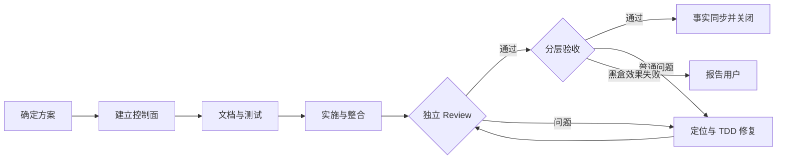

# GTO-evidence-receipts

Task ID: `20260920-101849-507587-gto-evidence-receipts`

## 施工摘要

| 项目 | 内容 |
| --- | --- |
| 目标 | 修复GTO验收证据登记与关闭脱节：受控追加终态证据引用、提前检查、单一证据真源，并发布后恢复原聊天任务。 |
| 改造范围 | skills/global-task-orchestrator/scripts/orchestrator_ctl.py skills/global-task-orchestrator/schemas/orchestrator-task-state.schema.json tests/harness/test_gto_verification_evidence.py tests/harness/test_gto_verification_evidence_acceptance.py skills/global-task-orchestrator/SKILL.md skills/global-task-orchestrator/references/state-schema.md skills/global-task-orchestrator/references/usage-modes.md skills/global-task-orchestrator/references/revision-3-results.example.json |
| 不做 | 不改原任务已完成结果、候选、验收结论或失败历史，不降低关闭门槛。 不修改业务产品或受保护模块，不新跑AI场景，不提交推送Git。 不覆盖或清理当前harness既有未提交改动。 |
| 实施方式 | 独立文档和测试先行，原实现者最小修复及整合，独立完整审查后只发布GTO；真实CLI验证合法补录与拒绝边界，保留原任务同一state与真实身份。 |
| 验收 | EVIDENCE-01：原作者可追加合同要求的缺失证据引用，原终态结果和历史保持不变；来源、身份、哈希、候选、引用错误均拒绝且零修改。 GATE-01：验收登记时核对所属证据关联，CLOSE前汇总所有必需证据；引用已登记证据，无业务键硬编码或第二份事实。 RELEASE-01：独立测试和审查通过，受控同步GTO安装副本与receipt一致，安装版CLI验收与幂等同步通过。 |
| 主要风险 | 保护harness既有dirty基线；只修改获批GTO范围。 不能把补录当作重验或授权失败结果通过；非法请求不得改变六工件。 |

## 改造要点

| 编号 | 改造结果 | 责任 | 验收 |
| --- | --- | --- | --- |
| REQ-01 | 受控追加证据且保护历史、身份和候选。 | 落实：DOC-001、TEST-001、WORK-001、INTEGRATE-001 | 验收：EVIDENCE-01 |
| REQ-02 | 提前检查与单一证据引用。 | 落实：DOC-001、TEST-001、WORK-001、INTEGRATE-001 | 验收：GATE-01 |
| REQ-03 | 独立验证与受控发布。 | 落实：INTEGRATE-001、REVIEW-001、ACCEPT-001、CLOSE-001 | 验收：RELEASE-01 |

## 施工流程

## 任务表

| 步骤 | 责任 | 交付 | 前置条件 |
| --- | --- | --- | --- |
| DOC-001 | doc-curator | 先明确已批准行为和边界，不提前指定独立测试答案；最终接口与独立测试协调后同步。 | 无 |
| TEST-001 | tester | 独立冻结行为测试与真实CLI验收，先最小Red，不写实现。 | DOC-001 |
| WORK-001 | backend-implementer | 只按独立行为测试最小修复controller/schema，保留旧结果与门禁，真实Red/Green。 | TEST-001 |
| INTEGRATE-001 | backend-implementer | 原实现者整合证据追加及提前门禁，核对全部文档与回归，不改独立测试。 | WORK-001 |
| REVIEW-001 | reviewer | 独立完整审查身份、引用、候选、原子拒绝、历史不可变及全部文档，发现问题先证明。 | INTEGRATE-001 |
| ACCEPT-001 | tester | 独立安装版真实CLI验收全部三个条目；核对受控发布和本地拒绝边界，无模型调用。 | REVIEW-001 |
| CLOSE-001 | doc-curator | 核对正式文档与已验收事实，纯文字收尾；root维护六工件。 | ACCEPT-001 |
