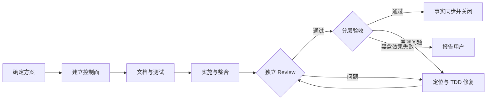

# GTO分批验收证据登记与汇总

Task ID: `20260920-155425-863065-gto-evidence-batches`

## 施工摘要

| 项目 | 内容 |
| --- | --- |
| 目标 | 修复GTO无法登记分批真实验收证据的问题：保留历史终态，登记已执行且独立评分的局部结果，核验当前适用性，汇总完整覆盖并用于正常关闭。 |
| 改造范围 | skills/global-task-orchestrator/scripts/orchestrator_ctl.py skills/global-task-orchestrator/scripts/acceptance_batches.py tests/harness/test_gto_acceptance_batches.py tests/harness/test_gto_acceptance_batches_cli.py skills/global-task-orchestrator/schemas/orchestrator-task-state.schema.json skills/global-task-orchestrator/SKILL.md skills/global-task-orchestrator/references/state-schema.md skills/global-task-orchestrator/references/usage-modes.md skills/global-task-orchestrator/references/revision-3-results.example.json |
| 不做 | 不改药品销售项目业务模块、测试题目、评分标准或既有原始输出。 不重跑完整20题、不伪造模型调用、不用局部通过改写历史整轮失败。 不直接编辑任务state或绕过review、候选、权限、证据、功能验收门禁。 不改无关harness文件、不清理既有dirty改动、不提交或推送Git。 |
| 实施方式 | 独立文档与测试先行；新增追加式局部证据登记及当前候选覆盖汇总，来源身份/原始输出/独立评分/输入/候选适用性哈希可重验，执行单元集合不能缩小或重复计数；现有full/scoped保留。源码独立Review后仅发布GTO，安装版真实CLI正反例验收，随后由原业务验收者恢复原同一任务并补真正失效的最小功能证据。 |
| 验收 | BATCH-01：历史environment_failure保留不变，可登记其中确已执行且独立通过的局部单元；新定向attempt诚实记录partial而非full，调用只记一次。 COVERAGE-01：依据冻结完整单元集合汇总当前候选覆盖，真实代码/输入失效、假身份、篡改、未执行、漏项、重复和冲突均拒绝；登记、validate与finalize重验。 RELEASE-01：独立源码审查及安装版CLI验收通过，仅发布GTO且source/install/receipt一致，旧full/scoped及预算和证据归属行为保持。 |
| 主要风险 | 现有harness未提交内容须采集基线并保留，只有获批范围允许增量修改。 旧证据当前适用性必须有可核验来源与独立审查，不能通过缩小依赖路径继承失效输出。 原业务功能验收仍独立核对；实际缺失证据不能以AI评分或GTO结构校验代替。 |

## 改造要点

| 编号 | 改造结果 | 责任 | 验收 |
| --- | --- | --- | --- |
| REQ-01 | 历史原始输出、独立评分与真实身份绑定，追加局部证据不改写失败。 | 落实：DOC-001、TEST-001、WORK-001 | 验收：BATCH-01 |
| REQ-02 | 完整单元集合、候选适用性、去重与证据重验；旧full/scoped门禁保持。 | 落实：TEST-001、WORK-001、REVIEW-001 | 验收：COVERAGE-01 |
| REQ-03 | 仅发布已审查GTO，安装版真实CLI验收；原业务同一state恢复且无全量AI重跑。 | 落实：INTEGRATE-001、ACCEPT-001、CLOSE-001 | 验收：RELEASE-01 |

## 施工流程

## 任务表

| 步骤 | 责任 | 交付 | 前置条件 |
| --- | --- | --- | --- |
| DOC-001 | doc-curator | 先冻结通用载荷/CLI/安全边界/适用性与单元完整性定义，不写产品实现。 | 无 |
| TEST-001 | tester | 独立定义最小TDD Red与真实CLI正反例；冻结来源、单元完整性、hash/身份/适用性/去重/原子拒绝，不改产品。 | DOC-001 |
| WORK-001 | backend-implementer | 按冻结合同实现最小追加式分批登记与聚合门禁，保留full/scoped和历史语义；只修产品，不改测试标准。 | TEST-001 |
| INTEGRATE-001 | backend-implementer | 与WORK同一原整合身份，核对全部接口与正式文档、目标Green和受影响旧回归，提供送审证据。 | WORK-001 |
| REVIEW-001 | reviewer | 独立完整审查候选，重点检查伪造适用性、漏项/重复、身份/归属、terminal不变、validate/finalize重验；发现者补证明。 | INTEGRATE-001 |
| ACCEPT-001 | tester | 原独立tester运行已发布安装版真实CLI定向正反例，不调用业务模型；结果映射BATCH/COVERAGE/RELEASE。 | REVIEW-001 |
| CLOSE-001 | doc-curator | 正式文档事实收口，不扩展功能；root控制器finalize此依赖修复并接续原业务任务。 | ACCEPT-001 |
