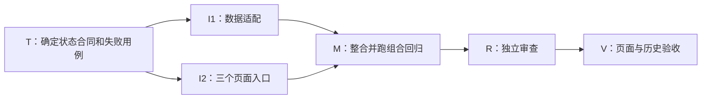

# 药代演练：让用户看懂“为什么没有总分”

这是可直接阅读的方案示例，不是已经实施的药代功能。2026-09-28 只读核对了现有项目 `D:/prj/drugsale_practice_system`；你早先写的 `D:/prj/drugsale/_practice/_system` 在本机不存在。下面的代理代号是示例分工，不是本次实际创建的代理。

## 施工摘要

**建议把“评价完成，但没有足够证据生成总分”作为正常结果讲清楚。** 用户应看到缺少哪些维度、为什么缺少，以及仍然有效的维度分数。评分规则保持原意，页面根据已保存评价解释结果。

现有后端允许维度标记为不可观察；前端总分类型仍声明为数字，评分面板和历史列表直接展示总分。因此需要先对齐空值与状态的表达，再统一三个展示入口。验收重点是“空分不误当零分、完成不误当失败、历史重开一致”。主要风险是只修当前评分面板，遗漏弹窗或历史列表。

## 改造要点

**REQ-01：明确区分三种结果。** 先判请求是否成功，再校验完整评价数据；有总分就展示总分，没有总分且存在不可观察维度时展示解释。总分为空但没有合法缺失原因时，按异常数据处理。这样不会把接口失败包装成正常的证据不足。

**REQ-02：解释必须来自这一场的评价。** 缺失维度的名称、数量和原因直接取保存结果；可观察维度的分数照常保留。雷达图缺失维度不绘成零分点，也不把空值加入平均数。

**REQ-03：当前面板、会话弹窗、历史详情使用同一规则。** 数据适配者负责统一状态与类型，页面实施者只消费约定结果；两者约定完成后可并行，公共类型只由数据适配者修改。

| 输入情况 | 用户看到的结果 | 验收实例 |
| --- | --- | --- |
| 五个维度都有有效评价 | 总分、维度分和依据 | 页面数值等于保存结果 |
| 两个维度不可观察 | 暂不计算总分；列出两个维度及原因 | 其余三个维度分数保留，两个缺失项不是 0 分 |
| 请求失败或评价数据不合法 | 明确的失败或异常说明 | 不展示“评价已完成，证据不足” |

拟议内容原型（文字原型，不是运行截图）：

> **本次评价已完成**  
> 暂不计算总分：有 2 个维度缺少评价依据。  
> 需求探索：本场未出现可供判断的相关交流。  
> 后续行动：本场未形成明确的后续约定。  
> 其余维度的分数与依据仍可查看。

上面的名称与原因只是示例数据；实际显示必须来自本场结果。内容原型用于审查信息顺序，不能代替视觉排版、键盘操作或真实浏览器验收。

## 施工流程

只有 I1 与 I2 可以并行，前提是 T 已明确输入状态和共享接口；M 等两个分支都完成。R 通过且页面环境就绪后才进入 V。A 先测试、后验收，这是施工前明确的复用；资源不足时可以排队，不能临时换人或跳过前置条件。返工遵循 GTO 的现行来源回路，不在此维护第二套流程。

## 任务表

| 步骤 | 责任 | 交付 | 前置条件 |
| --- | --- | --- | --- |
| T | A（测试） | 三种状态、空值、历史重开用例与共享接口约定 | 范围确认 |
| I1 | B（数据适配） | 空值类型与统一结果状态；落实 REQ-01、02 | T 完成；独占公共类型与适配函数 |
| I2 | C（页面实施） | 面板、弹窗、历史入口及缺失维度展示；落实 REQ-02、03 | T 完成；与 I1 可并行，不改其公共文件 |
| M | B（按计划复用，整合） | 接通真实数据并通过组合回归 | I1、I2 都完成 |
| R | D（审查） | 检查状态因果、入口遗漏和相关文档 | M 完成 |
| V | A（按计划复用，验收） | 三种输入的页面证据与历史重开证据 | R 通过、环境就绪 |

详细核对入口：评分判断位于项目的 `modules/simulation/domain/evaluation.py`；类型位于 `modules/web/src/api/simulation.ts`；页面入口为 `SimulationScorePanel.vue`、`SimulationConversationDialog.vue`、`SimulationHistoryView.vue`。正式实施时，T 需结合当时源码确定准确改动清单；本示例未修改这些文件，未运行药代业务验收。

这个例子中，**短段落解释因果，表格对照状态，文字原型审查用户读到什么，流程图审查先后与并行，任务表确认谁负责**。代码路径放在最后，需要追查时再读。
