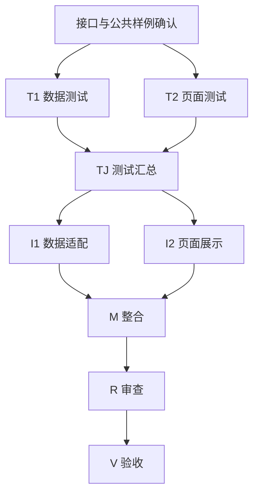

# Plan 阅读示例

本页只展示表达方式，不是实际批准合同或验收证据。字段与执行门禁见 [state-schema](state-schema.md)，方案与媒介选择见 [方案指南](plan-guide.md)，执行流程见 [任务流程](workflow.md)。

## 小修复：成功记录计数

**建议：一次成功只增加一次验证计数。** 假设首次成功被初始化与累加各计一次，用户会误以为方法已验证两次。把新记录初始化为零，由本次成功事件统一增加一次；既有记录继续正常累加。

验收实例：新记录第一次成功为 1，第二次独立成功为 2。重复提交如何识别按既有事件合同处理，不借此扩展幂等机制。

| 步骤 | 责任 | 交付 | 前置条件 |
| --- | --- | --- | --- |
| T | A（测试） | 首次计数错误的最小失败证明 | 计数规则明确 |
| I | B（实现与整合） | 修正计数并通过回归 | T 完成 |
| R | C（审查） | 检查计数变化与旧数据影响 | I 完成 |
| V | A（验收，按计划复用） | 从真实记录入口确认 1、2 两个结果 | R 通过 |

施工串行：T → I → R → V。关键风险是修改旧记录的历史计数，方案仅修新事件处理，不批量改历史数据。

## 普通功能：模拟演练无总分说明

**建议：评价已完成但证据不足时，明确说明为什么没有总分。** 保留既有评分规则；完整评价、部分维度证据不足、请求失败分别展示。不能把空值直接判成证据不足或显示为零分。

实现过程：取得有效评价 → 核对维度状态 → 有总分则展示；总分为空且存在证据不足维度则解释缺失项；状态不符合合同则报异常。维度名称、数量、原因来自同场已保存结果，不在页面编造。

| 场景 | 用户看到什么 | 验收 |
| --- | --- | --- |
| 完整评分 | 总分、维度分与依据 | 与保存结果一致 |
| 两维证据不足 | 暂不计算总分；列出两个维度与原因 | 已有分数保留，缺失项不是零分 |
| 请求失败 | 明确失败状态及允许操作 | 不误称证据不足 |

内容原型：“本次评价已完成｜暂不计算总分｜有 2 个维度缺少证据｜查看维度原因”。这是拟议展示，不是运行截图。

| 步骤 | 责任 | 交付 | 前置条件 |
| --- | --- | --- | --- |
| T | A（测试） | 三种状态和异常数据用例 | 页面范围及接口明确 |
| I | B（实现） | 数据适配与评分说明 | T 完成 |
| R | C（审查） | 数据与显示规则一致性 | I 完成 |
| V | D（验收） | 实际页面及历史重开证据 | R 通过、环境就绪 |

风险：当前页与历史页可能使用不同适配路径，两个入口都核对；语音设备效果不由结果展示测试代替。

## 复杂改造：数据与页面分支并行

**建议：接口和公共样例先明确，随后分开实施数据适配和页面展示，最后统一整合。** 两个分支互不写入对方文件；共享类型由数据适配责任者独占，页面按已确认接口开发。

| 步骤 | 责任 | 交付 | 前置条件 |
| --- | --- | --- | --- |
| T1 / T2 | A / B（测试） | 各自行为证明 | 接口明确，可并行 |
| TJ | A（复用，测试汇总） | 样例一致，组合测试可运行 | T1、T2 均完成 |
| I1 / I2 | C / D（实施） | 适配层 / 展示层 | TJ 完成，可并行；写入范围分开 |
| M | C（复用，整合） | 完整候选与组合验证 | I1、I2 均完成 |
| R | E（审查） | 候选审查与问题记录 | M 完成 |
| V | A（复用，验收） | 当前与历史入口的真实显示证据 | R 通过、验收环境就绪 |

用户审查重点：接口未稳定是否仍能并行、共享文件归谁、验收是否按计划复用 A。资源不足允许排队；不能把“可并行”变成“可跳过依赖”。返工沿原整合者及原发现者回路，不另画第二套治理图。
