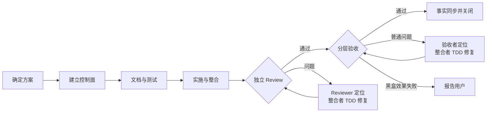

# 任务流程与职责

本页是 GTO 阶段顺序、角色职责、依赖与返工路线的唯一正文。方案内容和交接材料见 [方案编制与交接](plan-guide.md)；操作步骤见 [控制器指南](controller-guide.md)，字段及载荷见 [状态合同](state-schema.md)，机械门禁以同包 schema、控制器和真实验证结果为准。

## 适用范围与施工前置条件

- 纯问答、只读调研不属于施工，不要求建立任务控制面。
- 本页仅约束用户显式选择 GTO 的任务及已批准的 GTO 在途任务；普通工作按全局协作入口执行，不因需要简短方案而进入本流程。采用 GTO 后，先由 Plan 按 [方案指南](plan-guide.md) 给出可读方案，用户确认后由 Plan 写好六份工件，再交 Execute 实施；任务小时缩短内容，不跳过已选择流程的前置条件。
- 六份工件为 `docs/ai/tasks/<task_id>/state.json + task.md + events.jsonl` 与 `docs/tasks/<task_id>/plan.md + execution.md + acceptance.md`。窗口切换沿用同一 task_id；已有本次任务则继续，不重新初始化。
- 控制工件缺失、内容冲突或未确认时，Execute 不开始实施；先回 Plan 补齐。Plan 编制控制工件本身属于施工准备，不要求为它递归创建另一套控制面。
- 用户批准后，初始化控制面前只允许在消费项目根目录自己的 `.tmp/` 中写入一次性合同 JSON。`init-task` 成功、六工件通过 `validate`、任务进入首个适用执行阶段且 `preflight` 返回 `ready_for_delivery_writes=true` 前，禁止写入业务代码、正式测试、正式文档、`.gitignore`、manifest/lockfile/requirements、环境配置、项目脚手架、构建或部署资源以及其他交付内容。
- 控制器不能拦截平台文件工具。主协调器必须在首次派发交付子任务或首次交付写入前调用一次 `preflight`；失败时保持交付写入停止，修复同一控制面后重新检查。

## Plan 与 Execute 的职责

### 批准分工与依赖

新方案为每个子任务填写 `planned_agent_key`：同代号表示同一个真实代理，不同代号表示不同真实代理。测试代理兼任验收可以在方案中批准，不新增全面禁止；已有独立性约束仍在规划时核对。首次创建代号对应代理时记录平台返回身份，随后必须复用该身份，不能改名冒充另一计划代理。

`dependencies` 是唯一的串行和汇合定义；前置全部被接收为完成后才能开始。无相互依赖、无写入冲突且资源允许时可并行；资源不足可排队，不删除依赖或更换责任者。真实平台创建不代表可以写入：先核对计划，创建时只允许准备与等待，`bind-dispatch` 成功后才发送施工放行提示。控制器不能拦截绕过它的平台消息，主协调器负责遵守这个顺序。

批准校验包含初始任务的代理分配、职责、依赖、阅读与写入范围、assignment。控制器产生的返工、复审和验收尝试继承原计划代理与范围，不因正常回路反复申请批准；更换代理、扩大范围或改变初始依赖需说明并确认后更新同一合同。当前包仅接受完整的当前合同，计划代理字段必填；不读取旧合同作为可执行状态，不自动迁移或提供兼容分支。历史证据保留当时事实。

### 结果提交与核验

每次派发就提供对应角色的结果模板和证据位置；实际执行者据实填写，主协调器核验再接收。格式或身份错误先修正载荷；有效证据不重做，缺证据补验证，行为失败进入来源对应的返工回路。步骤与入口见 [结果合同](controller-guide.md#结果合同)，字段与身份见 [状态合同](state-schema.md#计划代理与只读结果预检)。

### 阶段职责与暂停恢复

- Plan 按 [方案指南](plan-guide.md) 编制方案、取得确认并完成同一任务控制面与交接。需要补上下文时可委派只读代理；不派实施者提前施工。
- Execute 主协调器读取既有任务摘要与合同，按已冻结依赖派发；根据本轮实际依赖结果撰写子代理提示，绑定真实身份、跟进输出、判断证据，并通过控制器更新任务状态。它不重新设计整套流程，也不重新初始化控制面。
- 子代理接收当前 assignment、关键输入、修改边界、验收要求和必要治理约束；不把完整任务历史当作默认输入。存在输入冲突、依赖未就绪或需要越界时回报。
- 控制器负责结构校验、依赖就绪、状态迁移、计数预算、哈希与证据关联、持久化和生成视图；它不理解业务、不重新拆任务、不代写实质提示或判断交付质量。任务语义、提示词和质量判断由主协调器负责。
- 范围内的条件分支、返工和复验按已批准路线执行。任务目标、拆分、依赖或验收条件确需改变时，回 Plan 说明并确认，然后更新同一合同。
- Plan/Execute 是职责阶段，可使用两个窗口；同窗口也必须保持先确认、先落盘、后执行的顺序。

暂停时保留同一 task_id、状态和证据；阻塞记录实际原因、原阶段及恢复所需证明。恢复先核对当前工作区、冻结运行版本与依赖能力，补齐真实成功证明后从原阶段继续；不重建任务或清零预算。具体动作见 [阻塞与恢复](controller-guide.md#必需能力不可达与恢复)，运行版本见 [运行与证据](runtime-evidence.md)。

## 通用施工流程图

图中“测试与实现”按任务适用性展开。纯文档或纯清理任务在 Plan 阶段写明不适用的代码测试步骤及实际验证替代，不为形式增加无意义测试或多余代理；实施前置条件和真实验收不能省略。

## 回路与阶段出口

- 普通 Review 和验收的发现者都必须先复现、定位根因、给出修复方案，并同步所有受影响的测试和文档；缺少真实失败测试或可执行证明时，不交付一个只有现象的问题给修复者。skill 效果黑盒按下节单独处理，不把效果失败自动送入普通返工回边。
- 返工只回原整合代理，由其确认 Red、完成 Green、相关回归和重新整合；不放宽失败测试，不改派原并行实施者返工。Review 来源回原 Reviewer 范围复审；验收来源回原验收者复验，不额外绕回 Reviewer。影响扩大时扩大验证范围，保留未失效的已有证据。
- “验收准备”不是所有任务都必须拥有的 PUBLISH 阶段。只有验收对象需要安装、部署或新会话时，才同步经过审查的实际候选；其余任务直接进入对应验收入口。
- 预算耗尽、必需能力不可达或流程前提失效时报告真实阻塞，按既有 SKILL 的预算和恢复合同处理；图中的回边不代表无限重试、自动换 ID 或绕过执行限制。

## 分层黑盒入口

黑盒按目标行为选择能提供可信证据的最低成本层级。层级、完整执行条件、统一场景卡、结果分类、预构造夹具、Memory/CFM 分离报告、L6 单次批准、runner 与主协调器边界，以及准备和停止规则，唯一见 [分层黑盒测试方法论](blackbox-methodology.md)。本页只说明黑盒在 GTO 总流程中的位置，不另写一套执行正文。

普通 Review 和普通验收 finding 仍按上方来源回路自动闭环；黑盒 `EFFECT_FAIL` 留证、定位根因并报告方案，不自动开始下一效果轮。通用证据真实性与自有产物清理边界见 [治理规范](../../../docs/SUBAGENT_GOVERNANCE.md#黑盒验收归因和清理)。

## 测试协作与文档清理

- 多个独立测试代理并行时，Plan 指定其中一名兼任测试负责人：先明确接口、公共夹具与覆盖分工，结束后汇总覆盖和组合运行结果。共享夹具单一写入者；职责复用，不固定新增测试整合代理。
- 测试阶段出口是测试契约一致、组合入口可运行、有效预期 Red 已确认；不要求实现前全部变 Green。产品整合者不能提前介入给独立测试答案。测试冲突交回对应测试者解决，不能直接交实施者放宽测试。
- 文档、测试准备和汇总不是产品实现，不要求为这些职责伪造产品 Red/Green。依赖按冻结 DAG 的可达关系判断：实现可以经测试汇总节点等待所需测试完成，不强制每个前置节点直接依赖全部测试。测试负责人可在准备、分支测试、汇总节点复用同一真实身份；独立性约束针对测试与实现/整合，而不是禁止同职责阶段复用。代码实现仍须有有效 Red/Green 与相关回归证据。
- 文档责任者覆盖本次涉及的全部现行规范、入口、模板与引用；既在前期同步，也在实施后全面收口，并在验收后查漏。历史记录保留当时事实，不冒充现行规范，也不为一致性改写历史证据。
- Plan 可把旧代码、旧测试和旧文档删除交给文档责任者。删除前核对已废弃或已有替代、没有活动调用方、必要覆盖保留，并形成明确清单；与并行实施者错开写入，删除改动在整合和 Review 前纳入候选。返工期间发现者的测试与文档责任不转交给文档代理。
- 最终纯文字和事实补齐不新增一轮独立文档审查；真正影响行为、契约或配置时返回原整合者和原验收者的闭环。

## 任务依赖能力与运行证据

Plan 在对应 assignment 声明必要能力及最小探针，派发前执行真实探针，preflight/bind 只读消费证明。冻结候选包括工具快照；验收输出直接长期留存。并发资源、字段及操作唯一见 [运行与证据](runtime-evidence.md)，不另建能力清单或第二套任务状态。
